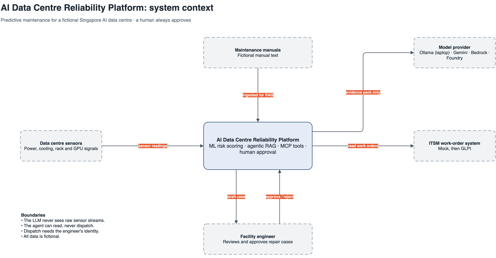

# AI Data Centre Reliability Platform

**Catch cooling and power faults before AI workloads suffer. An AI agent drafts the repair case, and a facility engineer approves it.**

> **Status: design phase.** This portfolio project uses fictional data only. Nothing here describes a real operator, and no results have been measured yet.

## The problem

AI racks depend on power and cooling. A degrading pump can heat a rack and throttle its GPUs before anyone links the signals, because alarms, GPU metrics, manuals and work orders sit in separate systems.

## The approach

1. **Sense:** read simulated power, cooling, rack and GPU signals.
2. **Predict:** use rules, or a small ML model if it beats them, to flag equipment at risk.
3. **Draft:** an agent checks manuals and past work orders, then writes a repair case with citations.
4. **Approve:** a facility engineer reviews the evidence and decides.

## Design principles

- **One design, swappable adapters:** platform, ITSM tool and GPU telemetry can change without rewriting business code.
- **Human approval:** the agent reads and drafts, and has no permission to approve or dispatch.
- **LLM only on alerts:** the LLM runs for high-risk alerts and never sees raw sensor streams.
- **Measured claims:** results will be published only from reproducible evaluation runs.

## Planned technology

Google ADK, Ollama, Qdrant, MCP, FastAPI and OpenTelemetry, starting on a laptop, then Google Cloud with Gemini.

## Results

Not measured yet. A demo and evaluation results will be added here when they are real.

## Source code

The full source is kept in a private repository. I'm happy to walk through it on a call.

## License

All rights reserved. You may view this repository, but no licence is granted to reuse its contents.
